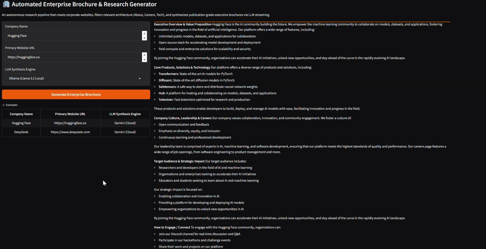

# 🏢 Company-Brochure-Generator: Enterprise Web Research & RAG Synthesis Pipeline

[](https://www.python.org/)
[](https://opensource.org/licenses/MIT)
[](https://gradio.app/)
[](https://www.docker.com/)

An autonomous corporate research and document synthesis engine. This pipeline scrapes public web properties, applies LLM reasoning with **strict JSON schema outputs** to curate relevant corporate architecture (About, Careers, Products), and compiles investor-ready marketing and executive brochures via **token-level real-time streaming**.

---

## 🏗️ Architecture Pipeline

```
[Target URL] ---> [Deep Scraper] ---> Extract candidate links (Top 40)
                                             |
                                             v
[Candidate Links] ---> [LLM Link Filter] ---> JSON Schema Output (About, Culture, Careers)
                                             |
                                             v
[Curated Subpages] ---> [Web Content Cleaner] ---> Stripped Content Aggregator
                                             |
                                             v
[Research Context] ---> [Dual Engine Router] ---> (Gemini 2.5 Flash / Llama 3.2)
                                             |
                                             v
                                  [Gradio Streaming UI]
                               (Token-by-Token Markdown)
```

---

## 🌟 Key Features

- **Autonomous Link Disambiguation**: Employs One-Shot Prompting and JSON Schema enforcement to filter out navigational boilerplate (ToS, Privacy Policy, Auth) and target high-signal corporate assets.
- **Context Extraction & Noise Reduction**: Automated DOM parsing using BeautifulSoup to strip scripts, styles, headers, and navigation trees, preserving clean semantic context within strict token budgets.
- **Dual Inference Support**:
  - **Google Gemini 2.5 Flash** (via OpenAI-compatible endpoint) for enterprise cloud synthesis.
  - **Ollama (Llama 3.2)** for privacy-first, on-premise local execution.
- **Live Markdown Streaming**: Full token-by-token streaming response rendered via an event-driven **Gradio Blocks** UI.
- **Container Parity**: Fully Dockerized with multi-stage lightweight builds and automated CI pipelines.

---

## 📂 Repository Layout

```text
├── .github/workflows/ci.yml   # Automated continuous integration pipeline
├── scraper.py                 # Resilient web extraction, URL resolution, DOM cleaner
├── generator.py               # JSON link classification & streaming brochure synthesis
├── app.py                     # Reactive Gradio interface
├── requirements.txt           # Minimal pinned dependencies
├── Dockerfile                 # Containerization specification
├── .env.example               # Environment variables configuration
└── README.md                  # Comprehensive documentation
```

## 📷 Screen Shot

---

## 🚀 Quickstart

### 1. Local Setup
```bash
git clone https://github.com/imehranasgari/Company-Brochure-Generator.git
cd Company-Brochure-Generator

# Create and activate virtual environment
python -m venv .venv
source .venv/bin/activate  # On Windows: .venv\Scripts\activate

# Install dependencies
pip install -r requirements.txt

# Configure environment variables
cp .env.example .env
# Set GOOGLE_API_KEY in .env

# Run application
python app.py
```
Open `http://127.0.0.1:7861` in your browser.

### 2. Docker Run
```bash
docker build -t brochure-generator .
docker run -p 7861:7861 -e GOOGLE_API_KEY="your_api_key" brochure-generator
```

---

## 👤 Author
**Mehran Asgari Roozbahani**
- **GitHub**: [@imehranasgari](https://github.com/imehranasgari)
- **Specialization**: Machine Learning Pipelines, LLM Systems & Tool Integration


## 📄 License

This project is licensed under the [MIT License](LICENSE).